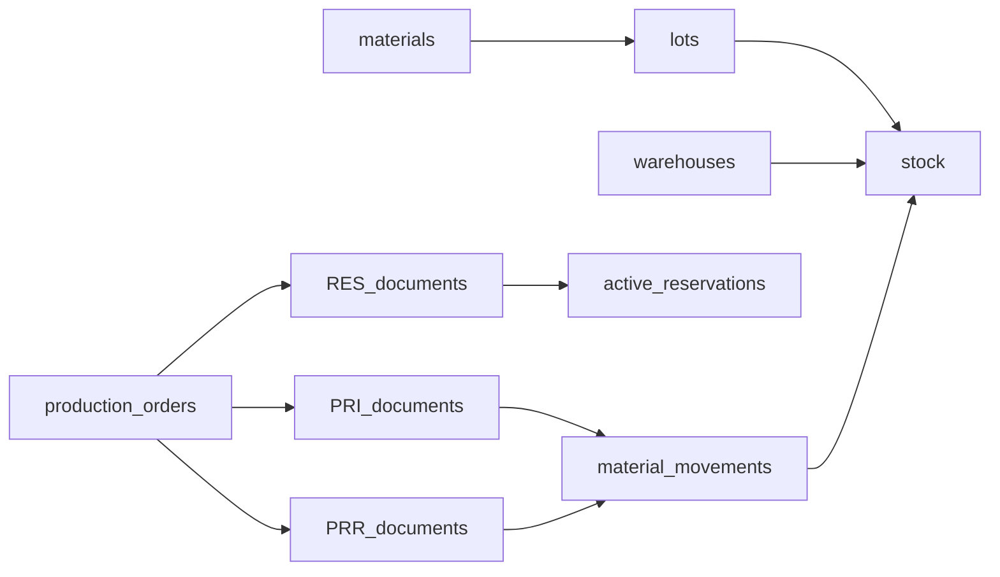

# Реляционное хранение: SQLite → PostgreSQL

Разбор для людей: [wiki/analyses/relational-storage-migration.md](../../wiki/analyses/relational-storage-migration.md).  
ADR: [D012](../../wiki/decisions/D012-relational-then-postgres.md). Связь с [D001](../../wiki/decisions/D001-sqlite-builtin.md).

## Зафиксированные решения

1. **Цель СУБД:** PostgreSQL (не MySQL / MariaDB).
2. **Путь:** двухэтапный.
   - **STOR1 (этап 1):** нормальные таблицы, UNIQUE/FK и SQL-доступ **в том же SQLite**; JSON-таблица `records` перестаёт быть источником истины.
   - **I1 (этап 2):** перенос **той же** логической схемы на PostgreSQL на пилоте.
3. **Без ORM-монстра в v1:** тонкий SQL gateway (`execute` / `transaction`), два драйвера (node:sqlite → `pg`).
4. **Границы транзакций** как сейчас: post/cancel документа, `completeOrder`, quality/LCH post — одна атомарная группа.
5. **Qty-only учёт** (как сейчас / SAP IM без денег). Оценка запасов и material ledger — вне скоупа.
6. **Секреты Postgres** только EnvironmentFile / `local/` — не в git и не в wiki.

## Зачем

Сейчас ([`backend/src/store.js`](../../backend/src/store.js)): одна таблица `records (collection, id, data JSON)`. Остатки, документы, заказы — целые JSON-документы. Плюс для пилота; минус для отчётов «на дату», UNIQUE на `(lot, warehouse)`, INT1 и роста писателей.

## Волны нормализации

Одна логическая схема для обоих этапов. Реализация кода — **по волнам** (отдельные ветки), не big-bang всего домена сразу.

| Волна | Сущности | Зачем раньше |
|-------|----------|--------------|
| **W1** | `stock`, `material_movements`, `active_reservations`, `production_register` | Горячий путь проводок; отчёты остатков/движений |
| **W2** | Шапка документов + `document_lines`; `document_sequences`; `document_status_log` | Post/cancel без blob строк |
| **W3** | `production_orders` + `order_lines` / `order_actual_lines` | Планирование / complete |
| **W4** | Справочники: materials, lots, warehouses, series, specs (+ lines), tech_maps, work_centers, substitutions, accounting_models, … | FK-якоря |
| **W5** | Качество / LCH: docs, registers, history, scenarios, defs | Guards качества |
| **W6** | users, roles, favorites, feedback; `chat_messages` | Auth/UX |

Пока волна не переключена на SQL — чтение/запись этой коллекции может оставаться в `records`. **Новые фичи** не добавляют зависимость от blob, если сущность уже в волне SQL.

## Целевые ключи и связи

Идентификаторы: `TEXT` UUID (как сейчас). Количества: `NUMERIC` / decimal-совместимый тип. Статусы: `TEXT` + CHECK (или enum-тексты приложения).

### Регистры (W1)

**`stock`**

| Колонка | Примечание |
|---------|------------|
| `id` PK | |
| `material_id` | денормализация; должна совпадать с `lots.material_id` |
| `lot_id` | FK → lots |
| `warehouse_id` | FK → warehouses |
| `quantity` | учётная ЕИ материала (см. G12) |
| UNIQUE | `(lot_id, warehouse_id)` |

**`material_movements`**

| Колонка | Примечание |
|---------|------------|
| `id` PK | |
| `material_id`, `lot_id`, `warehouse_id` | |
| `quantity` | со знаком |
| `type` | `receipt` \| `issue` |
| `at` | момент проводки |
| `document_id`, `document_number`, `document_type`, `document_status` | |
| `production_order_id`, `series_id`, `user_id` | nullable |
| INDEX | `(lot_id, at)`, `(document_id)` |

**`active_reservations`**

| Колонка | Примечание |
|---------|------------|
| `id` PK | |
| `document_id`, `production_order_id` | |
| `material_id`, `lot_id`, `warehouse_id`, `quantity` | |
| `series_id` | nullable |
| INDEX | `(production_order_id)`, `(lot_id, warehouse_id)` |

**`production_register`** — аналитика PRI/PRR; поля как сейчас в сервисе; не замена `stock`.

### Документы (W2)

Унифицированная шапка (все типы RCP…SHP):

- `id`, `type`, `number` — **UNIQUE `(type, number)`**
- `date`, `time`, `status` (`draft` \| `posted` \| `cancelled` \| `fulfilled`)
- `warehouse_id` / `warehouse_from_id` / `warehouse_to_id` по режиму
- `production_order_id`, `series_id`, `basis_document_id`, linked WOF/PST для INV
- audit: created/posted/cancelled/fulfilled + user ids
- `comment`

**`document_lines`:** `id`, `document_id` FK, `line_no`?, `material_id`, `lot_id`, `quantity`, опц. `book_quantity` / `actual_quantity` (INV); позже слоты ЕИ (G12).

Либо одна таблица шапок с `type`, либо `documents` + check — предпочтительно **одна** `stock_documents` + `document_lines` + `type`, чтобы не плодить 9 DDL.

### Заказы (W3)

- `production_orders` — скалярные поля статуса/дат/qty/spec/WC/series/material
- `order_plan_lines` / `order_actual_lines` — развёртка нынешних embedded arrays

### Справочники и качество (W4–W5)

- `lots.material_id` FK; мягкие UNIQUE на `lots.number` / `series.number` — сначала audit, потом UNIQUE если данные чистые
- `quality_register`: **UNIQUE `(lot_id)`**
- `characteristic_register`: **UNIQUE `(lot_id, characteristic_id)`**
- history — append-only таблицы

## Слой доступа

| Сейчас | Цель |
|--------|------|
| `readAll` + find в JS | SQL `WHERE` / PK |
| `update` всего JSON blob | `UPDATE` колонок / upsert строки |
| `runWrite` BEGIN IMMEDIATE | тот же смысл: SQLite immediate; Postgres одна транзакция |
| Generic CRUD на blob | Постепенно → SQL repositories; closed registers по-прежнему не через «сырой» CRUD |

Файлы-якоря: [`store.js`](../../backend/src/store.js), [`documents.js`](../../backend/src/services/documents.js), [`planning.js`](../../backend/src/services/planning.js), [`stock.js`](../../backend/src/services/stock.js).

## Этап 1 — STOR1 (SQLite tables)

1. Версионируемый **migration runner** (таблица `schema_migrations`).
2. DDL волн W1→… в SQLite.
3. Скрипт **etl-from-records**: `records` → таблицы.
4. **Pre-audit:** дубли `(lot_id, warehouse_id)` в stock; битые FK; пустые lines.
5. **Checksum:** count строк; `SUM(quantity)` по stock; выборка документов post vs lines; сверка free qty (stock − reservations).
6. Переключить запись W1 (потом W2…) на SQL; `records` для мигрированных коллекций — read-only или удаление после green.
7. Тесты: [`backend/tests/chain.test.js`](../../backend/tests/chain.test.js) + UNIQUE/FK негативные кейсы.
8. Деплой пилота всё ещё файлом `.sqlite` (привычный pul / restart).

Критерий готовности этапа 1: горячий путь post/cancel/complete и регистры **не** читают JSON как истину; бэкап файла sqlite по-прежнему валиден.

## Этап 2 — I1 (PostgreSQL)

1. DDL той же логической схемы (диалект PG: типы, IDENTITY при необходимости для внутренних seq).
2. Выгрузка SQLite → Postgres (offline ETL или `pgloader` / свой скрипт).
3. Env: имена вроде `DATABASE_URL` или `PGHOST`/`PGDATABASE`/`PGUSER`/`PGPASSWORD` — только EnvironmentFile на ВМ; в wiki — **имена**, не значения ([ops/secrets-and-local](../../wiki/ops/secrets-and-local.md)).
4. systemd: Postgres + зависимость `vilar-op`; бэкап `pg_dump` в регламент P1.
5. **Cutover:** окно работ → freeze writes → бэкап sqlite offline → migrate → smoke (логин, остатки, post RCP, complete заказа) → мониторинг.
6. **Rollback:** вернуть файл sqlite + бинарь/`main` tag до PG; unit без Postgres.

Критерий готовности этапа 2: пилот на Postgres; sqlite snapshot сохранён offline; runbook отката проверен хотя бы dry-run.

## Риски и митигация

| Риск | Митигация |
|------|-----------|
| Дубли stock `(lot, warehouse)` | Audit + merge/fix до UNIQUE |
| Расхождение шапка/lines в JSON | Валидатор ETL; fail loud |
| Долгий `completeOrder` / блокировки | Те же границы txn; OPS1 метрики; на PG statement_timeout осознанно |
| Половина кода на `readAll` | Волны; запрет новых blob-зависимостей для мигрированных сущностей |
| Cutover без отката | Offline sqlite + `pg_dump` до переключения |
| Утечка пароля БД | EnvironmentFile / `local/`; `npm run wiki:secrets-lint` |
| Расхождение SQLite vs PG SQL | Один runner, два диалектных шаблона DDL; тесты на обоих CI/локально когда появится PG в dev |
| Chat / jsonl вне records | Отдельная волна W6; login_audit.jsonl можно не трогать в STOR1 |

## Связь с другими темами

| Тема | Связь |
|------|--------|
| **G12** UOM | Не блокирует STOR1; колонки ЕИ на document_lines удобнее после W2 |
| **R9** ПТО | Выигрывает от SQL движений и срезов |
| **INT1** 1С | После W1–W4; стабильные колонки = контракт |
| **OPS1** | Метрики writer до и после |
| **D001** | SQLite остаётся на этапе 1; меняется форма хранения внутри файла |

## Вне скоупа v1 реализации плана (документы)

- Код DDL/ETL в этом же «документальном» шаге не пишется — отдельные ветки после утверждения.
- MySQL.
- Смена бизнес-инвариантов GMP / статусов заказа.
- Полный отказ от JSONL audit-файлов.

## Чеклист внедрения (когда начнётся код)

- [ ] Migration runner + W1 DDL (SQLite)
- [ ] ETL + audit + checksum
- [ ] `applyStockDelta` / RES на SQL
- [ ] W2 документы
- [ ] W3 заказы
- [ ] W4–W6 по приоритету
- [ ] Dev Compose/local Postgres (для этапа 2)
- [ ] Скрипт cutover + rollback runbook в `DEPLOYMENT.md`
- [ ] Пилот: STOR1 на sqlite tables → затем I1 Postgres
