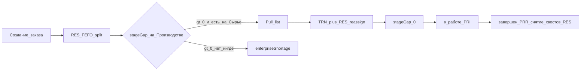

# G13 — RES split + Pull list staging

ADR: [D015](../../wiki/decisions/D015-reservation-pull-list-staging.md).  
Разбор: [wiki/analyses/reservation-pull-list-staging.md](../../wiki/analyses/reservation-pull-list-staging.md).  
Связано: [D009](../../wiki/decisions/D009-multi-warehouse-pri.md), [D010](../../wiki/decisions/D010-same-lot-multi-warehouse.md), [G2b](tech-maps-pp-pi-phases.md), [Q10](quality-stock-types.md), [wip-derived-from-orders](../../wiki/analyses/wip-derived-from-orders.md).

---

## 1. Цель

SAP-like контур обеспечения сырья под производственный заказ при нескольких складах (**Сырьё → Производство → ГП**):

1. При **создании заказа** сразу soft-резерв (FEFO/FIFO) с возможным **split** одной партии по складам.
2. Склад отпуска = **Производство** (`issueWarehouseId`); списание в производство (**PRI**) только с него.
3. Дыру на Производстве закрывает **Pull list** → TRN + **переназначение RES** с Сырья на Производство.
4. Свободное перемещение/списание зарезервированного запрещено (кроме Pull list своего контура и своего PRI).

Статус **«Обеспечен» не вводим** — при раннем RES он избыточен; на столах считаются `stageGap` и `enterpriseShortage`.

Склад «Производство» = **staging-буфер** до PRI, **не** qty-регистр НЗП (R9 без изменений).

---

## 2. Зафиксированные решения продукта

1. **Early RES:** create order (в т.ч. из plan-series) → posted RES; партии уже в резерве.
2. **Split:** одна GMP-партия / позиция спеки → несколько ног RES по складам (одна партия, разные `warehouseId`).
3. **Issue WH:** `productionOrder.issueWarehouseId` = склад Производство; PRI `warehouseId` **must** = issue WH (hard-block иначе).
4. **Pull list:** единственный легальный TRN qty под активным RES с **reassign** `warehouseId` строк RES (и `active_reservations`) Сырьё→Производство.
5. **freeQty-guard:** свободный TRN / WOF / SHP / чужой PRI ≤ `freeQty` (после Q10: UR − RES). Исключение G2b: свой PRI с `productionOrderId` — сверх RES warn, ниже stock/UR — нельзя.
6. **Нет статуса «обеспечен».** Машина: `новый` → `спланирован` → `в работе` → `завершен` | `отменен` (G2b). Индикаторы: `stageGap`, `enterpriseShortage`.
7. **Приоритеты pull list** — только UX стола (G13-d / WP11), без отдельной подсистемы.
8. **Промежуточные выпуски** не вводим; полуфабрикат = новая спека/заказ (как в идеологии SAP BOM).

---

## 3. Инварианты

| Инвариант | Правило |
|-----------|---------|
| Early RES | Create → posted RES (N документов по складам, дух [D009](../../wiki/decisions/D009-multi-warehouse-pri.md)) |
| Split | Одна партия на позицию → несколько RES-ног по складам |
| Issue WH | `issueWarehouseId` на заказе; PRI только с него |
| freeQty | Исходящие ≤ UR−RES (после Q10); over-issue своего PRI vs RES — warn (G2b) |
| Pull list | Единственный легальный TRN reserved qty + reassign RES |
| Обеспеченность | `stageGap` = qty резерва заказа **не** на issue WH (и/или need − stock на issue); **не** статус |
| Shortage | `enterpriseShortage` если need > free по всем релевантным складам — отдельно от stageGap |
| НЗП | Производство = staging; WIP отчётный = Σ PRI ([wip-derived-from-orders](../../wiki/analyses/wip-derived-from-orders.md)) |
| INV | Book = физ. qty; разница не должна молча делать RES > stock — флаг дефицита заказа |

---

## 4. Модель данных (целевая)

### 4.1 Заказ

- `issueWarehouseId` (обязателен для контура G13; дефолт — склад типа/кода «Производство» из справочника).
- Опционально later: `priority` (число/enum) — только сортировка на столе, не движок MRP.

### 4.2 RES / active_reservations

- Как сейчас: soft; ключ материал × партия × склад × заказ (документ).
- Split: несколько строк/`warehouseId` на один `lotId` одной позиции спеки.
- Reassign при post Pull list: уменьшить/снять ногу на from WH, увеличить/создать на to WH (= issue WH); тот же order/lot/material; без изменения суммарного reserved (если qty 1:1).

### 4.3 Pull list (новая сущность)

| Поле | Смысл |
|------|--------|
| шапка | `productionOrderId`, `fromWarehouseId`, `toWarehouseId` (= issue), status draft/posted/cancelled |
| строки | materialId, lotId, qty, `reservationRef` (documentId + line / active_reservation id) |
| post | создать/провести TRN (тот же stock type, дух Q10-C) + reassign RES; атомарно в write-транзакции |
| cancel draft | без движений |
| сторно posted | через R10 (TRN B + обратный reassign) — зависимость |

Не путать с ручным TRN в журнале документов: пользователь в перспективе идёт со **стола**; документ — аудит под капотом (WP11).

### 4.4 Вычисляемые показатели

- `stageGap(order)` ≈ Σ reserved qty заказа на складах ≠ `issueWarehouseId` (или need на issue − UR free на issue — зафиксировать одну формулу в реализации; канон: **остаток RES не на issue WH**).
- `enterpriseShortage(order)` ≈ max(0, need − Σ freeQty по складам, где FEFO/RES смотрит) по компонентам.

---

## 5. Волны реализации

### G13-a — Guards + issue WH

- Поле `issueWarehouseId` + дефолт Производство.
- PRI: hard-block если `warehouseId ≠ issueWarehouseId`.
- freeQty на TRN / WOF / SHP (выровнять с [Q10](quality-stock-types.md) A/B).
- Запрет свободного TRN qty под чужим/любым RES сверх freeQty.
- Желательно рядом с Q10 (UR − RES).

### G13-b — Early RES + split

- RES при create / plan-series (FEFO split по складам).
- Адаптация стола планирования: убрать модель «только confirm → RES» как единственный путь; confirm → переплан / уточнение или deprecate.
- Снять валидацию «одна строка подбора на spec line = один склад» для **одной** партии; разные партии на одну позицию — по-прежнему GMP-запрет (без тогла смешения).
- G8 / interim D010 («сначала ручной TRN») — superseded.

### G13-c — Pull list

- CRUD/API: предложить из `stageGap`, draft, post (TRN + reassign), cancel draft.
- Инварианты post: qty ≤ reserved на from; to = issue WH; партии из RES-ног.
- Отчёты/карточка заказа: stageGap, enterpriseShortage.

### G13-d — UX later (не блокирует a–c)

- **WP11** стол кладовщика (очередь stageGap, создание/проведение pull list).
- Reverse pull list (отмена/переплан после staging).
- Частичное обеспечение как продуктовые правила.
- Сортировка очереди по дате / `priority` заказа — только UI.
- Фоновые/событийные пересчёты срока годности и качества на зарезервированном.
- JIT staging по фазам — после G2b-b.

---

## 6. Конфликты с планами и кодом

| ID | Конфликт | Решение G13 |
|----|----------|-------------|
| **Confirm materials** | RES сегодня только на «подтвердить» | G13-b: create/plan → RES; confirm = переплан или deprecate |
| **G8 / D010 interim** | Сначала TRN, потом RES; запрет split | Target = split + Pull list; G8 superseded by G13; D010 → целевой путь G13 |
| **G2b статусы** | Без `обеспечен` | Согласовано; `спланирован` ≠ «всё на цехе» |
| **G2b withdrawn** | Match order+material+lot(+warehouse) | После reassign PRI гасит ноги на **issue WH** |
| **Q10-A** | TRN ≤ freeQty | Исключение: post Pull list своего order (TRN + reassign) |
| **Q10-B / G2b** | Over-issue PRI | Без изменений: warn vs RES; hard vs stock на issue WH |
| **R9** | «Без цехового склада» для WIP | Staging WH ≠ WIP register; формула R9 не меняется |
| **D009** | N RES/PRI | Сохраняется; reassign меняет warehouse ноги |
| **R10** | Сторно TRN / reverse reassign | Pull list posted сторнировать через R10 (+ обратный reassign) |
| **Atomic complete** | RES fulfill на complete | G2b-b: withdrawn + fulfill хвостов; G13 не возвращает atomic как канон |

### Не конфликтует

D002 (заказ-оркестратор), D001, GMP one-lot (split складов ≠ смешение партий), soft suppliers, D014 типы остатка (FEFO только UR).

---

## 7. Риски

| # | Риск | Митигация |
|---|------|-----------|
| A | Ручной «обеспечен» мимо остатков | Статуса нет; только stageGap |
| B | PRI с Сырья в обход | G13-a hard-block |
| C | Свободный TRN увозит чужой RES | freeQty + только Pull list |
| D | RES > stock после INV | Флаг дефицита; разбор RES/переплан |
| E | Два заказа, общий буфер Производства | RES режет free; очередь на столе |
| F | Отмена после staging без возврата | G13-d reverse pull list |
| G | Confirm и create оба плодят RES | Один канон пути в G13-b |
| H | Reassign без TRN / TRN без reassign | Post Pull list только атомарно |

---

## 8. Later backlog (ROADMAP идеи)

- WP11 — стол кладовщика / staging.
- U5 — уведомления: различать `stageGap` vs `enterpriseShortage`.
- Reverse pull list; частичное обеспечение; event/фоновые пересчёты.
- JIT по фазам (G2b + G13).
- Богатая приоритизация (не нужна, пока хватает сортировки UI).

---

## 9. Критерии приёмки по волнам (будущий код)

**G13-a:** нельзя PRI не с issue WH; нельзя TRN/WOF сверх freeQty; issueWarehouseId на заказе.

**G13-b:** новый заказ из плана имеет posted RES; партия 10+10 / need 15 резервируется split; стол планирования работает с early RES.

**G13-c:** из stageGap создаётся pull list; post → stock и RES на Производстве; stageGap=0 при полном закрытии дыры; свободный TRN той же qty — отказ.

**G13-d:** стол показывает очередь; документы не обязательны как первичный UX.
