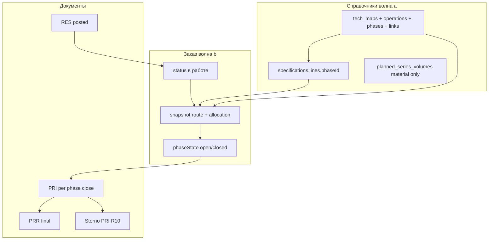

# Техкарты PP-PI: фазы, allocation, закрытие со списанием

Разбор: [wiki/analyses/sap-routing-operations.md](../../wiki/analyses/sap-routing-operations.md).  
Связано: [tech-maps-series-planning](../../wiki/concepts/tech-maps-series-planning.md), [order-status-machine](../../wiki/concepts/order-status-machine.md), [pri-prr-complete](../../wiki/entities/pri-prr-complete.md), [ORDER_STATUS_GUARDS](../ORDER_STATUS_GUARDS.md), [D013](../../wiki/decisions/D013-storno-new-document.md) / [R10](storno-stock-documents.md), [Q10](quality-stock-types.md), [D009](../../wiki/decisions/D009-multi-warehouse-pri.md), ROADMAP **G2b** → **G11**.

---

## 1. Цель продукта

Описать **маршрут производства** (PP-PI: операции → фазы, параллель, нормы времени) и исполнять заказ **по фазам**:

1. Человек закрывает фазу на рабочем столе заказа.
2. Создаётся/проводится **PRI** (списание на заказ+фазу) с **ручным фактом** qty — без скрытых проводок.
3. После закрытия всех фаз — **PRR** (выпуск ГП); заказ → `завершен`.

Отдельный qty-слой «НЗП» **не** вводим: сырьё уходит со склада при PRI; ГП появляется при PRR.

---

## 2. Зафиксированные решения

1. **PP-PI:** операция (РЦ) → фазы; связи FS по умолчанию; явная параллель.
2. **Одна техкарта — много спек** (`techMapId`); состав только в спеке.
3. **Время:** `duration` на фазе + `baseQty` на **шапке** техкарты; scale `× (orderQty / baseQty)`. Люди — позже, поля аддитивны.
4. **Allocation:** строка спеки → **одна** `phaseId`; `null` = первая фаза. Два этапа одного сырья → две строки.
5. **РЦ** на операции; фазы наследуют; desktop/отчёты подстраиваем.
6. **PRI** = дух SAP 261: обязательны `productionOrderId` + `phaseId`; не WOF.
7. **PRR** после закрытия **всех** фаз снимка (для линейного — «последняя»; для графа — нет открытых фаз).
8. **Волны:** **a** справочник+allocation+объёмы; **b** исполнение. Архитектура обеих — здесь.
9. Статусы: `новый` → `спланирован` → **`в работе`** → `завершен` | `отменен`.
10. **Снимок** маршрута + allocation при переходе в `в работе`.
11. Параллельные фазы — любой порядок; последовательные — после предшественников.
12. **RES не дробим.** PRI гасит withdrawn по материалу/партии. **Сверх резерва можно** (предупреждение, не hard-block).
13. Ошибки: отмена закрытия = **сторно PRI (R10)** + reopen фазы; UX на столе заказа; сначала откатить зависимые более поздние.
14. Atomic `complete` заменяется цепочкой; старые заказы — миграция / однофазный снимок.
15. **`planned_series_volumes`:** ключ только `materialId → quantity` (без РЦ); при слиянии дублей — **max(qty)**.

---

## 3. Целевая архитектура

### 3.1 Слои



### 3.2 Модель данных

#### Техкарта (волна a)

| Сущность | Поля (минимум) |
|----------|----------------|
| `tech_maps` | `id`, `name`, `baseQty` (>0). `workCenterId` — **убрать** или deprecated derived от первой операции |
| `tech_map_operations` | `id`, `techMapId`, `number`, `name`, `workCenterId` |
| `tech_map_phases` | `id`, `techMapId`, `operationId`, `number`, `name`, `durationMin` (≥0) |
| `tech_map_phase_links` | `id`, `techMapId`, `fromPhaseId`, `toPhaseId`, `type`: `FS` \| `SS` \| `FF` \| `SF` |

Хранение MVP: JSON-коллекции рядом с `tech_maps` **или** вложенные массивы в записи техкарты (проще UI). Перед STOR1 — отдельные коллекции предпочтительнее (меньше боли миграции).

Инварианты:

- ≥1 операция, ≥1 фаза.
- Рёбра links не создают неразрешённый цикл для scheduling MVP (детект цикла при save).
- Без links: неявная цепочка по `number` возрастанию (миграция).

#### Спека

`SpecLine.phaseId?: string | null` — FK логический на фазу **текущего** `techMapId`.  
При смене `techMapId`: сбросить `phaseId` в null (default первая) или reject save со списком строк.

#### Заказ (снимок, волна b)

```text
order.routeSnapshot = {
  baseQty, techMapId, techMapName,
  operations: [...],
  phases: [{ id, operationId, number, name, durationMin, workCenterId }],
  links: [...]
}
order.allocationSnapshot = [
  { specLineId, materialId, phaseId, plannedQtyPerBase } // qty норма на момент снимка
]
order.phaseStates = { [phaseId]: 'open' | 'closed' }
order.phaseCloseDocs = { [phaseId]: [priDocumentId, ...] } // для сторно/аудита
```

`order.workCenterId` на волне b: **планировочный ярлык** = РЦ первой операции снимка или явный primary; отчёты могут показывать список РЦ фаз.

#### Документы

| Тип | Новое | Поведение |
|-----|-------|-----------|
| PRI | `phaseId` (обяз. для контура фаз); `productionOrderId` уже есть | post = write-off + production register; обновление RES withdrawn |
| PRR | guard: все фазы `closed` | как сейчас + заказ → завершен (в том же user-flow, не скрыто) |
| RES | без дроби | withdrawn-агрегат по materialId+lotId+order (новое поле или пересчёт из PRI) |

Мультисклад (**D009**): при закрытии фазы — как сейчас, **N PRI по складам** строк факта; у всех один `phaseId`.

### 3.3 Машина статусов (цель)

| Переход | Из | Условие | Эффект |
|---------|-----|---------|--------|
| Подтвердить материалы | новый / спланирован | — | RES posted → `спланирован` |
| Начать производство | спланирован | есть RES posted; есть techMap/снимок возможен | snapshot → `в работе` |
| Закрыть фазу | в работе | предшественники closed; PRI draft→post | phase closed; stock − |
| Выпустить ГП | в работе | все фазы closed | PRR post; RES fulfilled → `завершен` |
| Отменить закрытие фазы | в работе | нет «блокирующих» поздних closed **или** они уже отменены | сторно PRI; phase open |
| Отменить заказ | новый / спланирован | — | как сейчас |
| Отменить заказ `в работе` | в работе | **запрет**, пока есть posted PRI/PRR без сторно; или отдельная процедура | открытый вопрос UX: только через сторно всех PRI |

Факт «сохранить actualLines» на весь заказ (старый) в волне b **сужается**: факт вводится в контексте закрытия фазы.

Канон обновить: `docs/ORDER_STATUS_GUARDS.md`, wiki `order-status-machine`, `pri-prr-complete`.

### 3.4 RES withdrawn (волна b)

Сейчас: `active_reservations.quantity` = зарезервировано; PRI **не** уменьшает эти строки до fulfill на complete.

Цель:

- При post PRI: увеличить `withdrawnQty` на строках RES (или отдельный ledger), match по order + material + lot (+ warehouse).
- `remaining = reserved - withdrawn` (не ниже 0 для индикатора; **факт PRI может превысить reserved**).
- Soft warning в UI: «факт X > остаток резерва Y».
- Hard-block **нет** (решение продукта).
- При финальном PRR / завершении: RES → fulfilled как сейчас.
- Сторно PRI: уменьшить withdrawn.

---

## 4. Конфликты с планами и кодом

| ID | Конфликт | Решение в G2b |
|----|----------|----------------|
| **Q10-B** | Q10: PRI не ниже RES (freeQty). G2b: сверх резерва **можно** | **Явное исключение:** для PRI с `productionOrderId` (+ фаза) — over-issue разрешён; SHP/WOF/прочий PRI без заказа — правило Q10-B. Зафиксировать в Q10 при реализации («кроме production over-issue»). |
| **Q10 UR** | PRI только с unrestricted | **Согласовано** — G2b не трогает QI/Blocked. |
| **R10** | Отмена закрытия нуждается в сторно-документе | **Зависимость:** волна b отмены **после или вместе** с R10. До R10 не делать «тихий cancel» как целевой UX. |
| **R11** | Частичное сторно строк | Не требуется для MVP отмены фазы (полное сторно PRI фазы). |
| **STOR1** | Новые сущности | Волна a в JSON-коллекциях ok; DDL операций/фаз — в STOR1 backlog. |
| **D009** | N PRI по складам | Сохранить; `phaseId` на каждом. |
| **G12** | ЕИ | Duration в минутах (не UOM материала). Сырьё в PRI — после G12 со снимком ЕИ на строке. |
| **G11** | Мощности | Потребитель duration; не в G2b. |
| **Atomic complete** | `completeOrder` | Волна b: deprecate; guards запрещают complete если у заказа multi-phase snapshot; однофазный миграционный путь optional. |
| **feedback `в работе`** | Статус тикета | Другая сущность — коллизии строк нет. |
| **План объёмов × WC** | Уникальность material+WC в API | Сломать → material only; обновить `index.js` validate, seed, customerRecipes, FE. |
| **production_register** | Пишется на PRI/PRR | Добавить `phaseId` в снимок строки регистра (желательно волна b). |

### Не конфликтует

D002 (заказ-оркестратор), D001 sqlite, GMP one-lot (факт по-прежнему выбирает партии), soft suppliers.

---

## 5. Риски и уязвимости

| # | Риск | Серьёзность | Митигация |
|---|------|-------------|-----------|
| A | Гонка: два пользователя закрывают одну фазу | Высокая | `runWrite` + optimistic version / guard «уже closed»; один posted PRI-контур на фазу final |
| B | Over-issue уводит склад в минус | Высокая | По складу hard-block «недостаточно free/UR» **остаётся**; over только vs RES, не vs stock |
| C | Смена техкарты/спеки после `в работе` | Высокая | Снимок заморожен; правки мастера не влияют; смена спеки на заказе в `в работе` — запрет |
| D | Смена техкарты у спеки ломает phaseId | Средняя | Reset phaseId + предупреждение в UI |
| E | Параллель + отмена: откатили не ту фазу | Средняя | Guard по графу зависимостей; список «сначала отмените …» |
| F | Забыли PRR, все фазы closed | Средняя | На столе явный CTA «Выпустить»; отчёт «заказы в работе без выпуска» |
| G | Миграция plan-volumes: два WC → один material | Средняя | max(qty); лог в changelog; ручная ревизия справочника |
| H | R10 не готов, делают cancel legacy | Высокая | Не открывать «отмену закрытия» в UI до R10; или feature-flag |
| I | Цикл в phase links | Средняя | Валидация при save техкарты |
| J | Путаница операции vs фазы в UI | Средняя | Подписи: «Участок (операция)» / «Шаг (фаза)»; в закрытии — только фазы |
| K | Partial close без «final» → много PRI на фазу | Низкая/средняя | MVP: **одно** успешное закрытие фазы = final; допроведение запрещено (проще сторно+заново). Открыть позже при необходимости |
| L | Отмена заказа `в работе` с остатками списанного | Высокая | Запрет cancel заказа до сторно всех PRI (и не-выпущенного PRR) |

**Уточнение B (важно):** «сверх резерва» ≠ «в минус по складу». Физический остаток / unrestricted / (после Q10) free от чужих RES — по-прежнему охраняется.

---

## 6. API / UX (чеклист)

### Волна a

- CRUD tech map с вложенным редактором операций/фаз/связей.
- CRUD spec line: select фазы из техкарты.
- `planned_series_volumes` без `workCenterId`.
- Derived WC для создания заказа (первая операция), пока нет волны b.

### Волна b

- `POST /api/planning/orders/:id/start` → snapshot + `в работе`.
- `POST /api/planning/orders/:id/phases/:phaseId/close` → создаёт draft PRI(и) или сразу post (предпочтение: **создать draft → пользователь проводит** в том же мастере стола, без скрытого post; если UX «одна кнопка» — внутри всё равно вызывается тот же `postDocument`).
- `POST /api/planning/orders/:id/phases/:phaseId/reopen` → create storno drafts (R10) + после post сторно → phase open.
- `POST /api/planning/orders/:id/release` → PRR + complete status (замена complete).
- Убрать или ограничить `completeOrder`.

Принцип: **все движения только через документы** (согласовано с Q10 scenarios).

---

## 7. Фазы поставки

### G2b-a — Волна 1

1. Модель + UI техкарты; миграция 1 op + 1 phase.
2. `phaseId` в спеке; default первая фаза.
3. Plan volumes без WC (max при merge).
4. Derived WC; не ломать plan-series/заказ.
5. Wiki + userGuide справочников; complete **не** трогать.

### G2b-b — Волна 2

1. Статус `в работе` + guards + docs.
2. Snapshot при start.
3. Стол заказа: фазы, close → PRI, release → PRR.
4. RES withdrawn + over-issue warning; stock hard-block.
5. Reopen через R10; запрет cancel заказа с открытыми списаниями.
6. Deprecate atomic complete; миграция открытых заказов в однофазный снимок при первом start.
7. `phaseId` в production register / отчётах.
8. ADR D0xx + sync wiki / ORDER_STATUS_GUARDS / userGuide.

### Вне скоупа

НЗП-регистр; backflush; люди/CRP (G11); production version; PI-sheet; допуски сырья; дробление RES; multi-close одной фазы (K).

---

## 8. Не делать

- Цеховое списание через WOF.
- Скрытый `applyStockDelta` при «закрыть фазу».
- Дробить RES по фазам.
- Одна строка спеки на несколько фаз.
- In-place edit posted PRI.
- Over-issue ниже нуля склада / UR.
- Отмена закрытия до R10 через legacy cancel как целевой дизайн.

---

## 9. Порядок относительно других тем

```text
рекомендуемый:
  G2b-a  (можно параллельно Q10-a, G12-a, STOR1-W1)
  R10    (желательно до G2b-b reopen)
  G2b-b
  G11    (после duration на фазах)
```

Q10 и G2b-b оба трогают PRI/stock guards — **не merge в одном PR без согласования freeQty vs over-issue RES** (см. §4 Q10-B).

---

## 10. Todos

- [ ] G2b-a: operations/phases/links + UI + миграция tech_maps
- [ ] G2b-a: SpecLine.phaseId + валидации смены techMap
- [ ] G2b-a: planned_series_volumes без WC (max merge)
- [ ] G2b-b: статус `в работе` + snapshot + ORDER_STATUS_GUARDS
- [ ] G2b-b: close phase → PRI; release → PRR; desktop UX
- [ ] G2b-b: RES withdrawn; over-issue warn; stock hard-block
- [ ] G2b-b: reopen via R10; deprecate completeOrder
- [ ] Согласовать текст исключения Q10-B в плане Q10
- [ ] ADR D0xx + wiki + userGuide после merge волн
