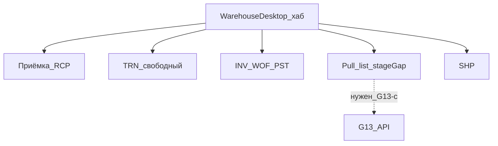
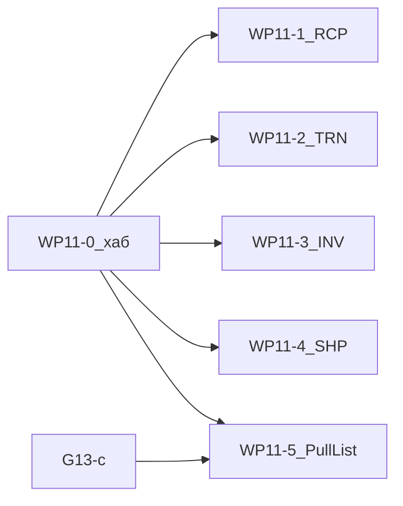

# WP11 — Рабочий стол кладовщика

Разбор: [wiki/analyses/warehouse-desktop.md](../../wiki/analyses/warehouse-desktop.md).  
Обеспечение / Pull list: [reservation-pull-list-staging.md](reservation-pull-list-staging.md) (**G13**), ADR [D015](../../wiki/decisions/D015-reservation-pull-list-staging.md).  
Паттерн UI: [QualityDesktop.tsx](../../frontend/src/components/QualityDesktop.tsx), kit [ui-kit](../../wiki/concepts/ui-kit.md).

---

## 1. Цель

Интерактивный **рабочий стол**, с которого кладовщик выполняет складские операции через удобные формы. Документы (RCP/TRN/INV/WOF/PST/SHP, Pull list) создаются и проводятся **под капотом** — как аудит. Журнал «Документы» остаётся запасным путём и режется **ролями** (не хардкод «запретить create» в MVP).

Операции на столе:

1. **Приёмка** (RCP; при необходимости новая партия — смысл **WP7**)
2. **Свободное перемещение** (TRN)
3. **Инвентаризация** (INV → черновики WOF/PST)
4. **Обеспечение потребности** (Pull list / `stageGap` — **G13**)
5. **Отгрузка** (SHP)

**Не на столе:** PRI / PRR / RES (цех, планирование); STT / QCM (качество); старт WOF/PST без INV.

---

## 2. Зафиксированные решения

1. **Стол = основной UX;** ручное создание документов **остаётся**. Ограничение «только стол» — через RBAC (снять create на `doc_*`, оставить `warehouse_desktop`).
2. **Один пункт ROADMAP WP11** (не WP12): полный стол, не только staging.
3. **Паттерн:** сценарий → форма → confirm → create/post документа; ссылка в журнал.
4. **Свободный TRN ≠ обеспечение заказа.** На форме TRN — дисклеймер + deep-link в «Обеспечение».
5. **Обеспечение** использует сущность/API Pull list из **G13-c**; очередь/сортировка UI = **G13-d** (этот стол). До G13-c плитка «Обеспечение» — disabled / «скоро».
6. **WP7** поглощается волной 1 стола (inline-партия в форме приёмки).
7. **Q10:** до внедрения типов остатка — приход/отпуск в UR; после — поле stock type на формах RCP/SHP/TRN по канону Q10.
8. **R10:** со стола — cancel draft; posted — через контур сторно, не «удалить проведение».



---

## 3. Nav / RBAC

| Элемент | Значение |
|---------|----------|
| objectId | `warehouse_desktop` |
| label | Рабочий стол кладовщика |
| kind | `desktop` |
| nav | группа «Запасы» (первым пунктом) или рядом с другими desktop |
| права | view/create по objectId; create на doc_* — отдельно (роли) |

Константы: `frontend/src/constants/systemObjects.ts`, `navConfig.ts`, `navVisualTypes.ts`; BE `backend/src/constants/systemObjects.js`.

---

## 4. Макет хаба

```text
+------------------------------------------------------------------+
| Рабочий стол кладовщика                    [склад: Сырьё ▾]     |
+------------------------------------------------------------------+
|  Очередь внимания (бейджи)                                       |
|  [ Обеспечение: N ]  [ Черновики: M ]  [ Shortage: K ]           |
+------------------------------------------------------------------+
|  Операции                                                        |
|  +--------------+ +--------------+ +--------------+              |
|  | Приёмка      | | Перемещение  | | Инвентар-ция |              |
|  | RCP + партия | | свободный    | | план→факт    |              |
|  +--------------+ +--------------+ +--------------+              |
|  +--------------+ +--------------+                               |
|  | Обеспечение  | | Отгрузка     |                               |
|  | Pull list    | | SHP          |                               |
|  +--------------+ +--------------+                               |
+------------------------------------------------------------------+
|  Недавние со стола → ссылка в журнал документа                   |
+------------------------------------------------------------------+
```

Фильтр «мой склад» сужает очереди и дефолты from/to; смена склада в форме не блокируется.

Бейджи `stageGap` vs `enterpriseShortage` — задел под **U5** (не полноценные push-уведомления в MVP WP11).

---

## 5. Формы процессов

### 5.1 Приёмка → RCP (+ партия)

```text
Приёмка
  Склад-получатель | Дата | Поставщик
  Строки:
    Материал | Партия [существующая ▾] | [+ новая партия]
    Новая: номер, производитель, даты (, stock type после Q10)
    Qty
  [Создать черновик] [Провести]
  → lot (если новый) + RCP
```

Вилки: новая vs существующая партия; до Q10 — только UR.

### 5.2 Свободное перемещение → TRN

```text
Перемещение (свободное)
  Откуда | Куда
  Подсказка: «Не для обеспечения заказа» → ссылка Обеспечение
  Строки: материал | партия | qty (≤ freeQty)
  Конфликт RES (G13): strict → ошибка; warn → модалка ack+причина
  [Провести]
```

### 5.3 Инвентаризация → INV → WOF/PST

```text
Инвентаризация
  Склад → [Заполнить план из остатков]  (stock-preview API)
  Таблица: материал | партия | учёт | факт | дельта
  [Провести INV] → черновики WOF/PST
  Список следствий → провести WOF/PST со стола
```

Ручной старт WOF/PST без INV на столе **не** предлагаем.

### 5.4 Обеспечение → Pull list (G13)

```text
Обеспечение потребности
  Фильтры: дата / priority заказа | только stageGap>0
  Очередь: Заказ | продукт | stageGap | shortage? | [Обеспечить]
  Мастер:
    from → to (= issueWarehouseId, read-only)
    строки из RES-ног (партия/qty); частичное qty ok
  [Создать] [Провести] → TRN + reassign RES
  enterpriseShortage: отказ + ссылка на Приёмку / переплан
```

Канон движка — [reservation-pull-list-staging.md](reservation-pull-list-staging.md); стол не дублирует бизнес-правила.

### 5.5 Отгрузка → SHP

```text
Отгрузка
  Склад | Контрагент | Дата
  Строки: материал | партия | qty (≤ free; enforcement как TRN)
  [Провести]
```

---

## 6. Волны реализации (код)

| Волна | Содержание | Блокер |
|-------|------------|--------|
| **0** | `WarehouseDesktop`, nav, objectId, хаб + бейджи-заглушки | — |
| **1** | Приёмка + inline-партия (**WP7**) | RCP API |
| **2** | Свободный TRN + дисклеймер; модалка RES после G13-a | TRN API |
| **3** | INV + follow-up WOF/PST | inventory stock-preview |
| **4** | SHP | SHP API |
| **5** | Очередь stageGap + Pull list UX | **G13-c**; сортировка = G13-d |

Порядок волн 1–4 гибкий; **5 строго после G13-c**. Мерж — отдельные ветки от `main`.



---

## 7. Конфликты / согласование

| ID | Тема | Решение |
|----|------|---------|
| **G13** | Движок Pull list | Стол = UX; API/инварианты в G13 |
| **G13-d** | Очередь staging | = волна 5 WP11 |
| **U5** | Уведомления | Бейджи на хабе — задел; push later |
| **Q10** | Типы остатка | Поля на формах после Q10 |
| **R10** | Сторно | Draft cancel на столе; posted → R10 |
| **WP7** | Inline-партия | Волна 1; в ROADMAP — отложено до реализации |
| **WP3** | Журнал документов | Остаётся; роли режут create |
| **WP8** | Жёсткий Admin CRUD | Не трогаем |

---

## 8. Критерии приёмки

- Кладовщик выполняет 5 операций со стола без обязательного захода в «Документы».
- Документы видны в журнале с корректным типом/номером.
- Свободный TRN не маскируется под обеспечение заказа.
- Pull list закрывает `stageGap`; при `enterpriseShortage` — понятный отказ.
- Роль без `warehouse_desktop` не видит пункт; без create на `doc_*` — работа только со стола (если так настроено).

---

## 9. Вне объёма (later)

- ТСД / штрихкод (**INT3**)
- Reverse pull list (остаётся в G13-d backlog)
- Полноценные push-уведомления (**U5**)
- Мобильный «только проведение» (**U6**) — может переиспользовать формы стола позже
