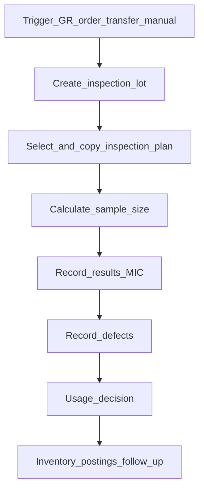

# Анализ: Inspection Lot в SAP QM

Статус: синтез query (только факты SAP Help / Learning / таблицы). Обновлено: **2026-11-04**.  
ROADMAP: **Q11** (расширение качества ↔ состояние остатков). Связано: [quality-stock-types](quality-stock-types.md) (**Q10**), [qcm-quality](../entities/qcm-quality.md), [lch-characteristics](../entities/lch-characteristics.md).

Источники: [Using the Inspection Lot](https://learning.sap.com/courses/applying-sap-s-4hana-quality-management/using-the-inspection-lot_e117d3a1-e7ce-4aad-9246-c0f176f8e388), [GR inspection](https://learning.sap.com/courses/applying-sap-s-4hana-quality-management/processing-inspections-at-good-receipt_bf84141a-43bd-4744-a9f8-988655750611), [Performing Usage Decisions](https://learning.sap.com/courses/implementing-sap-s-4hana-quality-management/perfoming-usage-decisions_e926fbdd-a525-472d-8dfe-f34ebdc0849f), поля **QALS** / **QAVE**.

---

## Что это простыми словами

**Inspection lot** (контрольная партия / лот контроля) — учётный объект QM: «вот это **количество** материала (часто с номером партии) нужно проверить».

Это **не** складской остаток и **не** master партии.  
Метафора из аналитики таблиц: лот — **вопрос** («годно ли это qty?»); ответ — **usage decision** (QAVE) + (для stock-relevant) **разнесение qty** по типам остатка.

Один лот = один номер `PRUEFLOS`. На него вешают план контроля (снимок), результаты MIC, дефекты, UD, и — если лот управляет stock — disposition qty (UR / Blocked / scrap / …).

---

## Жизненный цикл (SAP Learning)

1. **Создание** — событие (GR по PO, выпуск/приём из производства, stock transfer, release заказа, delivery, recurring inspection по сроку, **ручное** создание). Нужен активный **inspection type** в material master.
2. **Выбор и копирование плана** — спецификации копируются **в лот**; дальше правка master-плана **не** меняет уже созданный лот.
3. **Расчёт выборки** — sample size по sampling procedure на характеристиках.
4. **Результаты** — quantitative / qualitative MIC.
5. **Дефекты** — коды + текст; опционально Quality Notification.
6. **Usage decision** — один код решения по **всему** лоту (+ quality score).
7. **Проводки / follow-up** — для stock-relevant: выход qty из QI в UR / Blocked / …; обновление batch characteristics, уведомления и т.д.

Статусы лота система ведёт сама (до/после inspection; UD сделан; stock postings complete — см. флаги вроде STAT34/STAT35 на QALS).

---

## Связь с партией (batch)

| Факт | Деталь |
|------|--------|
| Поле на лоте | `QALS-CHARG` — номер партии |
| Не тождество | Партия (MCHA/batch master) ≠ inspection lot. Создание лота **не** создаёт партию само по себе |
| Кардинальность | Стандарт: **один stock-relevant lot ↔ одна партия** на этом лоте. **Одна партия — много лотов** возможна (повторные приёмки, recurring, 349 Blocked→QI → новый lot origin 08) |
| «Несколько партий в одном лоте» | В стандартном GR-сценарии **не** поддерживается как норма; для разных партий — разные лоты (или batch split на GR) |
| Характеристики партии | После UD результаты MIC могут **скопироваться** в batch classification (если MIC связан с class characteristic). Пишутся на **master партии целиком**, не на «только blocked qty» |

Настройки **lot summary** (control inspection lot): лот на каждый material document item / на material+batch / на PO item и т.д. — влияют, сколько лотов создаётся при повторных GR одной партии.

---

## Где хранится (таблицы — ориентир)

| Таблица | Содержание |
|--------|------------|
| **QALS** | Шапка лота: `PRUEFLOS`, материал, завод, qty (`LOSMENGE`), origin (`HERKUNFT`), партия (`CHARG`), ссылки на PO/vendor, **корзины disposition** `LMENGE01`…`09`, `LMENGEZUB` (ещё не разнесено) |
| **QAVE** | Usage decision(s): код, valuation A/R; ключ с счётчиком (возможны перезаписи/reset — брать актуальный) |
| Результаты MIC | Отдельные таблицы результатов (напр. QAMR / QASE — не в QALS) |
| Дефекты / уведомления | QMFE / QMEL…; уведомление может ссылаться на `PRUEFLOS` |
| Связь с IM | Материал-документы проводок; QAMB и др. связывают lot ↔ движения |

**Важно:** QALS знает **сколько** ушло в Blocked (`LMENGE04`), но **не** хранит «почему» — причины в UD-коде, дефектах, notification, reason на MSEG, опц. batch class.

---

## Stock-relevant vs не stock-relevant

- **Stock-relevant** (типичный GR): при создании qty попадает в **QI**; лот **управляет** этим qty до полного posting. Пока так — выход из QI через QM (UD / stock posting лота), не «голый» MIGO 321.
- **Не stock-relevant** (часть in-process / ручных): лот для результатов и UD **без** обязательного управления IM-qty.

Разбиение при UD: на вкладке Inspection Lot Stock можно отправить часть в UR, часть в Blocked, sample/scrap — **в рамках одного лота и одного UD-кода**. Отдельного «документа качества только на blocked slice» нет (см. [quality-stock-types](quality-stock-types.md)).

---

## Vs Vilar сегодня

| SAP | Vilar |
|-----|--------|
| Inspection lot на **qty + событие** | Нет сущности лота контроля |
| План → снимок в лоте | Сценарии авто-QCM; LCH отдельно |
| UD + stock posting | QCM → `quality_register` на **всю** партию; stock не двигает |
| Много лотов на одну batch | Один регистр качества на `lotId` |

**Q10** закрывает корзины UR/QI/Blocked + STT (IM-слой).  
**Q11** — процессный QM-слой (аналог lot / результаты / причины / связь disposition с остатками); глубина копирования SAP — **ещё не зафиксирована** (см. ROADMAP).

---

## Развилки для Q11 (не выбирать молча)

1. Полная сущность «inspection lot» vs упрощённый «кейс контроля» (событие + qty + статус без полного плана/выборки).
2. Один кейс на RCP-строку vs на партию vs на разбиение STT.
3. LCH остаётся отдельно или входит в результаты кейса как MIC.
4. Defect/cause catalogs и Q8 (notification) — внутри Q11 или отдельными пунктами.
