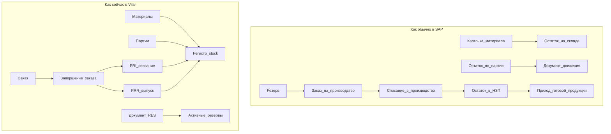

# Анализ: сверка Vilar OP с SAP (склад + производство)

Статус: синтез query. Обновлено: **2026-11-03**.  
Скоуп: материальные потоки, запасы, производство, планирование. **Без** финансов, цен и бухгалтерских проводок.  
Дорожную карту (`docs/ROADMAP.md`) этот разбор **не меняет** — только ссылается на уже известные темы.

Связано: [uom-units-of-measure](uom-units-of-measure.md), [pto-manual-form](pto-manual-form.md), [document-lifecycle](../concepts/document-lifecycle.md), [stock-registers](../entities/stock-registers.md), [production-order](../entities/production-order.md), [D002](../decisions/D002-order-as-orchestrator.md), [D009](../decisions/D009-multi-warehouse-pri.md), [D010](../decisions/D010-same-lot-multi-warehouse.md).

---

## Словарь

### Модули SAP (крупные «коробки»)

| Сокращение | Расшифровка | Простыми словами |
|------------|-------------|------------------|
| **SAP** | Systems, Applications and Products | Крупная ERP; эталон процессов учёта |
| **ERP** | Enterprise Resource Planning | Единая система учёта ресурсов предприятия |
| **MM** | Materials Management | Материалы: номенклатура, закупки, запасы |
| **IM** | Inventory Management | Складской учёт внутри MM: остатки и движения |
| **PP** | Production Planning | Планирование и учёт производства |
| **QM** | Quality Management | Управление качеством |
| **FI / CO** | Finance / Controlling | Финансы — **вне сравнения** |
| **SD** | Sales and Distribution | Продажи — почти вне скоупа |
| **WM** | Warehouse Management | Ячейки, ТСД — позже |

### Понятия учёта

| Термин | Простыми словами |
|--------|------------------|
| **Остаток (stock)** | Сколько лежит сейчас (у нас: материал × партия × склад) |
| **Движение / проводка** | Изменение остатка после проведения документа |
| **Документ** | Оформленное событие (приёмка, перемещение, списание…) |
| **Проведение (post)** | Документ начинает влиять на остатки / резервы |
| **Отмена (cancel)** | Обратное влияние |
| **Резерв** | «Заморожено под заказ», физически ещё на складе |
| **Партия (lot / batch)** | Конкретная поставка/выпуск с номером и сроком |
| **Спецификация (BOM)** | Bill of Materials — состав продукта (у нас — спека) |
| **Техкарта (routing)** | Маршрут: этапы и рабочие центры |
| **Рабочий центр (WC)** | Work Center — участок / линия |
| **НЗП / WIP** | Work in Process — списали со склада, ещё не выпустили ГП |
| **ЕИ / UOM** | Unit of Measure — единица измерения |
| **Базовая ЕИ** | Единственная единица, в которой живёт остаток |
| **FEFO / FIFO** | Сначала с истекающим сроком / сначала поступившее |
| **GMP** | Good Manufacturing Practice — правила фармпроизводства |
| **MRP** | Material Requirements Planning — авторасчёт «что произвести/закупить» |
| **CRP** | Capacity Requirements Planning — хватает ли мощностей |
| **ПТО** | Баланс сырья / производственно-технический отчёт за период |

### Документы Vilar

| Код | Что это |
|-----|---------|
| **RCP** | Приёмка на склад |
| **TRN** | Перемещение между складами |
| **INV** | Инвентаризация (факт; остаток меняют дочерние документы) |
| **WOF** | Списание / уменьшение остатка |
| **PST** | Оприходование / увеличение остатка |
| **RES** | Резервирование под заказ (остаток не уменьшает) |
| **PRI** | Отпуск сырья в производство |
| **PRR** | Приход готовой продукции из производства |
| **SHP** | Отгрузка |
| **QCM** | Решение по качеству партии |

### Имена таблиц SAP (не обязательно запоминать)

| Имя | Смысл |
|-----|--------|
| **MARA** | Карточка материала |
| **MARD** | Остаток по складу (число в базовой ЕИ) |
| **MCHB** | Остаток по партии |
| **MKPF / MSEG** | Шапка и строки документа движения |
| **RESB** | Строки резерва / потребности |
| **261 / 101** | Типовые виды: списание в производство / приход из производства |

### Темы дорожной карты (ссылки)

| ID | О чём |
|----|--------|
| **G12** | Нормальные единицы измерения |
| **G2b** | Этапы и нормы в техкартах |
| **G11** | Мощности рабочих центров |
| **R9** | Отчёт в духе бумажного ПТО |
| **Q9** | Жёсткий запрет работы с заблокированной партией |
| **INT1** | Обмен с 1С / внешней ERP |
| **I1** | Postgres при росте нагрузки |
| **G10** | Глубокая прослеживаемость и ЭЦП |
| **D002 / D009 / D010** | Заказ ≠ движение; несколько складов в отпуске; одна партия на разных складах — пока через TRN вручную |

---

## 1. Короткий вердикт

Vilar OP сегодня — это:

1. Сильная **операционка под серии ЛП**: подбор партий, резерв, правила GMP.
2. Уже похожий на SAP **складской контур «только количества»**: документ → проведение → остаток.
3. Пока **тонкое производство**: заказ есть, но почти нет «жизни на цехе» между списанием сырья и выпуском готовой продукции.

**Сильные стороны:** проведение и отмена складских документов; заказ как оркестратор (сам склад не двигает); FEFO и партии.

**Слабые для превращения в учётную систему:** нет слоя «в производстве» (НЗП); завершение заказа сразу списывает сырьё и выпускает ГП одним шагом; единицы измерения ещё свободной строкой; нет надёжного среза остатков «на дату» для ПТО.

Это **не** ошибка пилота — осознанный срез. Риск появляется, когда продукт позиционируют как полноценный материальный учёт без достройки модели.

---

## 2. Как устроены данные

### Соответствия

| В SAP (смысл) | В Vilar | Оценка |
|---------------|---------|--------|
| Остаток по складу / партии (MARD / MCHB) | Регистр `stock`: материал × партия × склад, одно число | **Тот же класс модели** |
| Документ движения (MKPF / MSEG) | Типизированные документы + журнал `material_movements` | **Близко**; меньше видов движения; нет снимка ЕИ на строке |
| Резерв под заказ (RESB) | RES + `active_reservations` | **Дух тот же**; нет отдельного «запаса, принадлежащего заказу» |
| Списание в производство / приход ГП (261 / 101) | PRI / PRR | **Да**, но только при **полном** завершении заказа |
| НЗП между списанием и выпуском | — | **Главный разрыв** |
| Завод / оценка в деньгах | — | Вне скоупа — нормально |

Канон остатка: qty только в учётной ЕИ материала, без dual stock — как в разборе [UOM](uom-units-of-measure.md) (подход R1 ≈ остаток SAP).

---

## 3. Зрелость функциональных блоков (0–5)

Оценка экспертная по коду и wiki на 2026-11-03; не метрика KPI.

| Что оцениваем | Ориентир в SAP | Оценка | Коротко о Vilar |
|---------------|----------------|--------|-----------------|
| Карточка материала и единицы измерения | Материал + альтернативные ЕИ | **2** | ЕИ — свободный текст; план G12 |
| Партии и подбор FEFO / FIFO | Управление партиями | **4** | Сильная сторона GMP |
| Складские документы post / cancel | Складские проводки | **4** | RCP…SHP в пилоте |
| Резервирование | Резерв под заказ | **3.5** | Мягкий резерв; `stock` не уменьшается |
| Спецификация / состав | BOM | **3.5** | Фарм-спека + пересчёт содержания |
| Техкарта и рабочий центр | Маршрут / РЦ | **1.5** | Техкарта ≈ «какой РЦ»; этапы — идея G2b |
| Жизненный цикл заказа | Производственный заказ | **3** | Жёсткие статусы; завершённый штатно не откатить |
| Поэтапные подтверждения, частичный отпуск / выпуск | Подтверждения операций | **1** | Всё в шаге «Завершить» |
| НЗП («в производстве») | Запас в незавершёнке | **0.5** | PRI сразу убирает qty со склада |
| Автопланирование потребности | MRP | **0** | Серии вручную / plan-series |
| Мощности линий | CRP | **0** | Гант — визуализация; G11 — идея |
| Решение о годности партии | Usage decision (QM) | **3** | QCM + характеристики; нет отдельного карантинного qty |
| Прослеживаемость | Where-used по партии | **3** | Отчёты есть; глубокая цепочка — G10 |
| Обмен с внешней ERP | Интеграции | **0.5** | Идея INT1 |
| Платформа под рост пользователей | — | **2.5** | SQLite ок для пилота; Postgres — I1 |

**Сводно по доменам (среднее грубо):** склад ~3.5 · производство ~1.5 · качество ~3 · платформа ~2.5.

---

## 4. Осознанные упрощения vs то, что мешает росту

### Нормально для пилота

- Нет денег, цен, оценки запасов.
- Нет зоопарка из сотен видов движения.
- Один сайт вместо иерархии заводов.
- Нет полноценных закупок / продаж «как в большой ERP».

### Мешает росту в учётную систему

1. **Завершение заказа = сразу PRI + PRR** — нельзя честно показать «серия в работе», частичный выпуск, месяц посередине серии (см. [pto-manual-form](pto-manual-form.md)).
2. **Нет слоя НЗП** — ПТО и остаток в производстве требуют либо договорённости со складами, либо новой модели.
3. **Техкарта без этапов** — некуда повесить нормы времени и мощности без переделки (G2b).
4. **Единица измерения строкой** — риск при обмене с 1С и при смешении кг / г / уп (G12).
5. **Качество как свойство партии, а не тип остатка** — нет отдельного «карантинного количества» на складе (Q9).
6. **История отмен через обратные движения** — целевой канон **R10** ([storno-stock-documents](storno-stock-documents.md), [D013](../decisions/D013-storno-new-document.md)): новый документ-сторно + `postingDate`; частичное по строкам — **R11**.
7. **JSON-документы в SQLite** — удобно сейчас; потолок для сложных отчётов и синхронизации (I1).
8. **Одна партия на нескольких складах** — физически есть; в подборе без ручного TRN неудобно ([D010](../decisions/D010-same-lot-multi-warehouse.md)).

---

## 5. Точки роста (рекомендация, не правка ROADMAP)

### Сейчас — фундамент учёта

- Нормальные единицы измерения (**G12**): остаток по-прежнему одно число в базовой ЕИ; снимок ЕИ на строке документа.
- Явно решить политику **НЗП**: цеховой склад + TRN → PRI, или отдельный учётный слой «в производстве».
- Развязать завершение заказа: отдельно отпуск сырья и выпуск ГП (хотя бы частично), не ломая guards статусов.

### Следующий горизонт — глубина производства без полного MRP

- Этапы и нормы техкарт (**G2b**).
- Минимум подтверждений: «списали» / «выпустили».
- Отчёт ПТО на честной модели остатков (**R9**).
- Жёстче карантин и ясность «качество vs остаток» (**Q9**).

### Позже — масштаб и внешний мир

- Мощности РЦ после появления этапов (**G11**).
- Postgres при росте одновременных проведений (**I1**).
- Обмен с 1С после ЕИ и стабильных внешних кодов (**INT1**).
- Глубокая прослеживаемость / ЭЦП по реальной потребности GMP (**G10**).

---

## 6. Чего из SAP сознательно не копируем

- Оценку запасов и материальный леджер в деньгах.
- Полный авторасчёт MRP «как на заводе SAP».
- Ячейки и ТСД до отдельной складской темы (INT3).
- Два независимых остатка в разных единицах.
- Иерархию заводов «для галочки».
- Сотни видов движения без реальных событий у ВИЛАР.

---

## Итог одной фразой

По **складу** Vilar уже в правильном классе модели SAP (документ → qty-остаток, партии, мягкий резерв). По **производственному учёту** это пока оркестратор плана с терминальным списанием/выпуском — путь к учётной системе лежит через НЗП, развязку завершения заказа, ЕИ и этапы техкарты, а не через копирование финансового SAP.
