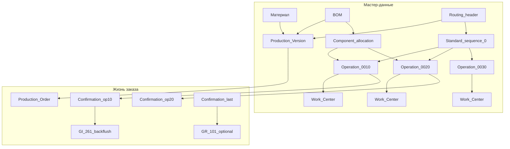
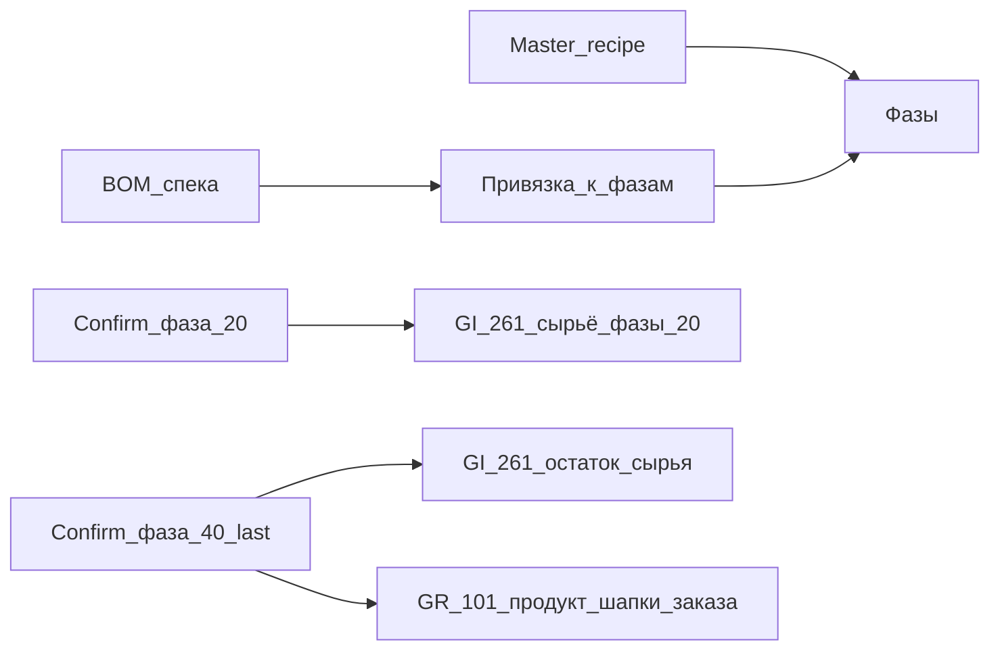

# Анализ: техкарта / маршрут в SAP (этапы, нормы) vs Vilar

Статус: синтез query. Обновлено: **2026-11-04**.  
Скоуп: PP-PI + исполнение по фазам (без отдельного qty-НЗП).  
План (детальный, риски A–L, конфликты Q10/R10): [docs/plans/tech-maps-pp-pi-phases.md](../../docs/plans/tech-maps-pp-pi-phases.md) (**G2b** есть план).

Связано: [sap-mm-pp-comparison](sap-mm-pp-comparison.md), [tech-maps-series-planning](../concepts/tech-maps-series-planning.md), [production-order](../entities/production-order.md), [pto-manual-form](pto-manual-form.md), ROADMAP **G2b** / **G11**.

---

## 1. Зачем SAP вообще нужна техкарта

В SAP **спецификация (BOM)** отвечает на «из чего», **маршрут (routing / recipe)** — на «где и как долго / в каком порядке».

Без маршрута система:

- не знает **последовательность** цеховых шагов;
- некуда повесить **нормы времени** (setup / machine / labor и т.п.);
- не считает **мощности** рабочих центров (CRP);
- не привязывает **списание компонентов** к моменту шага (component allocation + backflush);
- не умеет **подтверждать** частичный прогресс серии (confirmation по операции/фазе).

Именно поэтому в сверке Vilar пункт «техкарта без этапов» стоит рядом с «нет слоя НЗП»: оба — про жизнь **между** «заказ создан» и «ГП на складе».

---

## 2. Два мира SAP: discrete PP vs process PP-PI

Для фармы ближе **PP-PI** (process industry), но в разговорах чаще цитируют **routing** из дискретного PP. Смысл похож, структура разная.

| | Discrete PP (**Routing**) | Process PP-PI (**Master Recipe**) |
|--|---------------------------|-----------------------------------|
| Транзакции (классика) | CA01 / CA02 / CA03 | C201 / C202 / C203 |
| Единица исполнения | **Operation** (операция) | **Phase** (фаза) внутри Operation |
| Ресурс | Work Center на операции | Resource на операции; фазы наследуют |
| Нормы времени | На операции | На **фазе** (сумма фаз = операция) |
| Связь с BOM | Компоненты → операция | Компоненты → **фаза** |
| Подтверждение | CO11N по операции | Подтверждение по фазе (+ PI-sheet / control recipe) |
| Параллельность | Sequences (standard / parallel / alternative) | Relationships фаз (FS, SS, FF, SF) |

**Решение (2026-11-04):** целевая метафора Vilar — **PP-PI**: операция (группировка / ресурс) + **фазы** (исполняемые шаги) + **связи фаз** (в т.ч. параллель FS/SS/FF). Слово «этап» в разговоре = фаза, если не оговорено иначе.

Сознательно **не** копируем в пилоте: control recipe / PI-sheet, внешняя обработка (subcontract), калькуляцию по activity types. Secondary resources — см. §11 (люди), не как обязательный MVP.

---

## 3. Иерархия объектов маршрута (discrete)



### 3.1 Header (шапка маршрута)

Типично: материал + завод, **group / group counter** (несколько вариантов маршрута), usage, status, даты действия, **диапазон размера партии** (lot-size from/to).

Аналог у нас слабый: `tech_maps` — имя + один `workCenterId`; вариантность и lot-size range нет. Связь с продуктом — через `specifications.techMapId`, не через production version.

### 3.2 Sequence

- **Standard sequence (0)** — обязательна, линейный поток.
- **Parallel** — ветка рядом (перекрытие).
- **Alternative** — «или/или» путь.

Для пилота OP достаточно моделировать **только линейную последовательность** этапов. Parallel/alternative — позже или никогда.

### 3.3 Operation (этап / операция)

Ядро маршрута. Ключевые поля:

| Поле SAP | Смысл | Зачем |
|----------|--------|------|
| Operation number (0010, 0020…) | Порядок; шаг 10 — чтобы вставлять | Исполнение и планирование |
| Work center | Где выполняется | Мощности, формулы времени |
| Control key | Поведение: schedule? capacity? confirm? auto GR? | Политика шага без хардкода |
| Description | Текст шага | UI цеха |
| Base quantity | На сколько qty заданы нормы | Масштабирование на заказ |
| Standard values | Setup / Machine / Labor (набор задаёт WC) | Сроки, CRP, (в SAP ещё costs) |
| Component allocation | Какие позиции BOM «съедаются» здесь | Момент GI при backflush |
| PRT / insp. char. | Оснастка, in-process QM | Вне скоупа G2b MVP |

**Control key** — важный паттерн: не «все операции одинаковы», а флаги на шаге. Для Vilar можно упростить до enum поведения этапа, не копируя таблицу ключей SAP.

### 3.4 Standard values (нормы)

Набор полей норм определяет **standard value key** рабочего центра (не произвольный зоопарк на каждой операции).

Типичный ключ SAP1: Setup + Machine + Labor.

Нормы задают:

1. **Scheduling** — длительность заказа / дат этапов;
2. **Capacity** — нагрузка на РЦ (G11);
3. Costing — **вне скоупа** Vilar.

Формулы «как из нормы получить календарное время» живут на WC — это мост к G11.

### 3.5 Component allocation (привязка сырья к этапу)

- Каждая позиция BOM может быть привязана **только к одной** операции.
- Без явной привязки при создании заказа всё падает на **первую** операцию.
- При **backflush** подтверждение операции списывает только компоненты, назначенные на неё (движение 261).

Это прямое пересечение с НЗП: сырьё может уходить со склада **не в момент complete всего заказа**, а **по мере подтверждения этапов**.

### 3.6 Production Version

Связка «этот BOM + этот routing (+ lot-size)» для материала. В PP-PI часто **обязательна** для process order.

У Vilar сейчас: спека (состав) + `techMapId` на спеке + РЦ с техкарты при создании заказа. Отдельной сущности «версия производства» нет — и для G2b MVP, скорее всего, не нужна, пока один активный маршрут на спеку.

### 3.7 Снимок в заказ

При создании production order SAP **копирует** операции маршрута в заказ. Правка CA02 **не** обновляет уже созданные заказы автоматически (нужен re-read master data / ручная правка).

Инвариант для плана G2b: при переходе заказа в работу — **снимок этапов** на заказе, а не live-ссылка на мастер.

---

## 4. Исполнение: confirmation (не путать с «статусом заказа»)

| Понятие | SAP | Vilar сейчас |
|---------|-----|--------------|
| Статус заказа | CRTD / REL / CNF / DLV / TECO… | новый → спланирован → завершен/отменен |
| Подтверждение операции | CO11N: yield / scrap / факт времени | Нет |
| Частичный прогресс | Partial confirmation по операции | Нет; всё в atomic complete |
| Auto GR | Control key на (часто последней) операции → 101 | PRR только в complete |
| Backflush GI | 261 при confirmation операции | PRI только в complete |

Confirmation — отдельный слой событий «сделали шаг N на qty X». Именно он развязывает:

- сроки и факт по этапам;
- поэтапный расход сырья;
- частичный выпуск ГП (если auto GR / отдельный GR).

Без confirmation этапы техкарты остаются **только справочником** (полезно для норм и будущего Ганта/CRP), но не меняют складской контур.

---

## 5. Пересечение с НЗП (зачем помнить при G2b)

В SAP «НЗП» как материальный слой — не то же самое, что список операций. Два разных механизма часто работают вместе:

1. **Складской:** сырьё ушло (261) → заказ «держит» потребление; ГП ещё не пришла (101) → количество «в заказе / в процессе».
2. **Маршрутный:** операции показывают, *на каком шаге* заказ, и *когда* списывать/выпускать.

Варианты политики (уже в [sap-mm-pp-comparison](sap-mm-pp-comparison.md) / [pto-manual-form](pto-manual-form.md)):

| Политика | Роль этапов |
|----------|-------------|
| A. Цеховой склад + TRN, PRI = расход на выработку | Этапы могут быть **без** складских проводок (только нормы/прогресс) |
| B. Отдельный учётный слой «в производстве» | Этапы + confirmation сильнее связаны с моментом GI/GR |
| C. Как сейчас: PRI+PRR только в complete | Этапы = мастер-данные и UI; склад не трогают |

**Вывод для планирования:** G2b можно начать с **мастер-данных этапов + норм** без смены PRI/PRR; но если цель — честный ПТО / частичный выпуск, без решения по НЗП и confirmation этапы останутся «декорацией».

---

## 6. Как сейчас в Vilar (разрыв)

### Модель

```text
tech_maps: { id, name, workCenterId }
specifications.techMapId → техкарта
order.workCenterId ← часто из техкарты спеки
planned_series_volumes: materialId × workCenterId → qty
```

Код: коллекция `tech_maps`; тип FE `TechMap`; валидация в `backend/src/index.js` (имя + РЦ). Seed: «Техкарта: Линия 1/2» = один РЦ.

### Оценка зрелости (из сверки)

Техкарта / РЦ: **1.5 / 5** — по сути ярлык линии, не маршрут.

| Возможность SAP | Vilar |
|-----------------|-------|
| Несколько операций | Нет (0 этапов) |
| Разные РЦ на шагах | Нет (один WC на всю техкарту) |
| Нормы времени | Нет |
| Привязка компонентов BOM к шагу | Нет (спека целиком) |
| Снимок маршрута в заказ | Нет |
| Confirmation по шагу | Нет |
| Мощности от норм | Нет (G11 ждёт этапов) |

### Что уже «закрывает» другие объекты

- **Состав / нормы расхода материала** — спека (`qtyPerUnit` / assay), не техкарта. G2b про **время/маршрут**, не дубль BOM.
- **План серий** — объёмы на РЦ; останется валидным, даже если у техкарты появятся этапы (header WC или «основной» РЦ).

---

## 7. Решения по развилкам (2026-11-04)

| # | Вопрос | Решение |
|---|--------|---------|
| 1 | Метафора | **PP-PI**: операции + фазы + параллельные связи фаз |
| 2 | Волны | **Волна 1:** техкарта + спека (allocation). **Волна 2:** закрытие фаз + документы |
| 3 | РЦ | На фазах/операциях; desktop/отчёты подстроим |
| 4 | Нормы | Время + scale от base qty; люди позже |
| 5 | Спека | `techMapId` + allocation → фаза; пусто = **первая фаза** |
| 6 | Склад | Без qty-слоя НЗП; списание при закрытии фазы; выпуск после последней |
| 4b | Статус заказа | Нужен **`в работе`** (между спланирован и завершен) |
| 5b | Снимок | Маршрут + allocation **копируются на заказ** |
| 6b | Параллель | Параллельные фазы — в любом порядке; последовательные — по цепочке |
| 2/3 | Документы / complete | **PRI** на заказ+фазу; **PRR** в конце; atomic complete → цепочка; в том же плане G2b |
| 7 | RES | Не дробим; PRI гасит withdrawn; **сверх резерва можно** |
| 8 | Ошибки | Сторно закрытия (R10); UX на столе заказа; без скрытых проводок |
| 9 | Allocation / base | 1 строка спеки → 1 фаза; `baseQty` на **шапке** техкарты; нормы времени уже на фазах — расширение шагов позже ok |
| 10 | План объёмов | Убрать РЦ: ключ только **материал → qty** |

---

## 8. Расшифровка скоупа v1 (бывший вопрос 2)

Целевой процесс (зафиксировано): **закрытие фазы человеком → списание факта → после последней фазы документ выпуска**. Отдельный регистр «НЗП» не вводим.

| Слой | Что | Статус |
|------|-----|--------|
| **L1** справочник техкарты (операции/фазы/РЦ/время/параллель) + allocation в спеке | Нужен | В цели |
| **L2** снимок маршрута (+ allocation) на заказ | Нужен для исполнения | В цели |
| **L3+склад** закрытие фазы + документ списания; последняя фаза → выпуск | Целевой UX | В цели; **нарезка волн** открыта |
| Люди / CRP (G11) | Позже | Вне v1 |

Старый atomic `complete` = PRI+PRR разом — **заменяется** этим контуром (как именно — открыто, §13).

---

## 9. РЦ на этапах — куда ударит в Vilar (§3)

Сейчас `workCenterId` — плоский ярлык. После PP-PI истина РЦ — на **операции** (как resource в SAP; фазы наследуют).

### Где сегодня читается / пишется РЦ

| Место | Сейчас | После сдвига |
|-------|--------|--------------|
| `tech_maps.workCenterId` | Обязателен | Убрать или сделать **derived** (напр. РЦ первой операции / «планировочный») |
| `specifications.techMapId` → подстановка РЦ | Берёт WC техкарты | Берёт derived или требует явный выбор при нескольких линиях |
| `production_orders.workCenterId` | Одно поле | Оставить как **планировочный/основной** РЦ заказа **или** заменить снимком списка операций; UI заказа/desktop/отчёты |
| `planned_series_volumes` (material × WC) | Ключ плана объёмов | Скорее оставить срез по «линии»; уточнить = какой WC, если в карте их несколько |
| `plan-series` / `SeriesPlanningPage` | Default WC из техкарты | Default из derived; ручной override сохранить |
| `ProductionDesktop`, регистр, отчёты | Колонка «РЦ» заказа | Показывать основной + опционально «маршрут: N фаз / M РЦ» |
| Seed / миграции | Техкарта = линия | Нужен скрипт: одна операция + одна фаза с тем же WC |

**Инвариант, который нельзя сломать молча:** план объёмов и подстановка qty завязаны на `(materialId, workCenterId)`. Пока нет решения «что считать РЦ серии при много-РЦ карте», ключ плана сохраняем; derived header WC должен быть **явным правилом** (не «первый попавшийся»).

---

## 10. Нормы: длительность vs люди — за и против (§4)

В SAP это **разные** оси, часто путают:

| Ось SAP | Что это | Отвечает на |
|---------|---------|-------------|
| **Standard value «Duration / Machine / Labor time»** | Норма **времени** (ч) на base qty | Как долго займёт шаг |
| **Capacity category Person** на ресурсе | Сколько **мест/людей** доступно на РЦ | Хватит ли смены |
| **Secondary resource** | Доп. ресурс параллельно основной фазе | Нужен ли ещё смеситель / бригада |
| **Number of capacities / splits** | Детализация мощности | Сколько параллельных «единиц» |

«Сколько людей нужно на серию» ≈ **трудозатраты (чел·ч)** и/или **численность на шаге**, а не только wall-clock duration.

### Варианты для Vilar

| Вариант | Модель на фазе | Плюсы | Минусы |
|---------|----------------|-------|--------|
| **A. Только duration** | `durationMin` (или setup+run одной цифрой) | Просто; хватит для длины Ганта | Руководитель не видит людей; «2ч одним» = «2ч тремя» неотличимо |
| **B. Duration + headcount** | `durationMin` + `persons` (число людей на фазе) | Прямой ответ «сколько людей»; просто считать чел·ч = duration×persons | Не различает «станок ждёт» vs «люди работают»; грубо для разных ролей |
| **C. Duration + laborHours** | `durationMin` + `laborHours` (норма чел·ч на base qty) | Ближе к SAP labor time; удобно суммировать загрузку людей | Не видно «нужно 3 человека одновременно» без доп. поля; duration и labor могут расходиться |
| **D. Как SAP-lite** | duration (для расписания) + laborHours + опционально persons; мощность людей на карточке РЦ позже (G11) | Покрывает и «как долго», и «сколько труда», и базу CRP | Сложнее UI и обучение; риск недозаполнения |

**За A:** минимальный MVP, быстро.  
**Против A:** ваш кейс планирования («не только как долго, но сколько людей») не закрыт.  
**За B:** самый понятный язык для цеха («на фазе фасовки — 4 человека, 3 часа»).  
**Против B:** плохо моделирует «один аппарат + двое обслуж.» vs чистый труд; параллельные фазы с разными людьми — ок, но суммировать «пиковую смену» уже эвристика.  
**За C:** честные чел·ч для отчёта загрузки персонала.  
**Против C:** менеджер всё равно спросит «сколько человек в смене стоит у линии».  
**За D:** правильный долгосрочный каркас под G11.  
**Против D:** тяжеловато для первого merge.

**Решение (2026-11-04):** вариант **A + масштабирование**.

- На фазе: плановая длительность на **base quantity** техкарты (или фазы — уточнить в плане: один base на header recipe).
- На заказ/серию: `duration × (orderQty / baseQty)` (setup-отдельно не вводим, пока всё в одной цифре).
- Поля `persons` / `laborHours` **не** вводим в v1; расширение до B/C позже без ломки модели времени.

---

## 11. Сырьё по фазам и «полуфабрикаты на этапах» (как в SAP)

Отдельный вопрос (2026-11-04): списывается ли сырьё при закрытии этапа, и бывает ли выпуск полуфабриката внутри одной спеки/заказа.

### 11.1 Привязка сырья к фазе (component allocation)

В PP-PI позиции **BOM** (у нас — строки спеки) назначаются на **фазы** master recipe:

- явно: Materials / component allocation → фаза 0020, 0030…;
- если не назначили — при создании заказа всё падает на **первую** фазу.

При **подтверждении фазы** (confirmation), если компонент marked **backflush**:

- система берёт только компоненты, назначенные **этой** фазе;
- пропорционально подтверждённому qty считает расход по норме BOM;
- проводит **GI 261** (списание в заказ) — обычно с production storage location.

Можно и без backflush: ручной GI к заказу в любой момент; тогда confirmation только фиксирует прогресс/время.

**Важно:** это списание **входных** материалов заказа. Это ещё не «выпуск полуфабриката на склад».



### 11.2 Типовой поток одного заказа на продукт шапки

Заказ создан на **один** материал шапки (ГП или учтённый полуфабрикат как «заказ на него»).

1. Старт / release заказа — запасов продукта ещё нет.
2. Confirm фазы 10 → (backflush) списалась часть сырья, привязанного к 10.
3. Confirm фазы 20 → списалась следующая порция сырья…
4. Параллельные фазы — каждая списывает своё при своём confirm.
5. Confirm **последней** фазы с Auto GR (или отдельный GR) → **приход на склад материала шапки** (101).

Между шагами 2–4 физически «что-то варится», но в складском смысле SAP обычно держит это как **потребление на заказе / WIP заказа**, а **не** как отдельную партию полуфабриката на каждом этапе.

И да: «начали → закрыли этап → списалась часть сырья → … → в конце получили продукт» — это **каноническая** картина при backflush + Auto GR на последней фазе. Частичный GR шапки тоже возможен (несколько приходов), но это всё ещё материал **шапки**, не промежуточный код этапа.

### 11.3 Когда появляются «выпуски на этапах»

| Потребность | Как в SAP | Одна спека/заказ? |
|-------------|-----------|-------------------|
| Только понять прогресс и списать сырьё вовремя | Фазы + allocation + backflush | **Да**, один заказ на ГП |
| Нужен **остаток на складе** промежуточного (передать в другой цех, продать, держать буфер) | Отдельный **материал-полуфабрикат** + свой BOM + свой recipe/order; ГП имеет в BOM этот HALB | **Нет** — минимум две «спеки» (два BOM) и обычно два заказа (или collective / direct production) |
| Промежуточный не складируем, но разворачиваем его состав в заказ ГП | **Phantom** assembly (спец. закупка/признак) | Один заказ ГП; phantom не приходуется |
| Заодно с ГП выходят другие продукты | **Co-product / by-product** (отрицательные qty в BOM) | Один заказ; это **сопутствующий выход**, не «этап 2 = полуфабрикат» |
| Продать/оприходовать с середины маршрута как отдельный SKU | Обычно **отдельные материалы + collective orders**, не Auto GR на каждой операции одного заказа | Несколько заказов/кодов |

Правило большого пальца:

- **Этап внутри одного заказа** = прогресс + списание входов (+ опционально GR **шапки** в конце).
- **Складской полуфабрикат** = **другой материал** и, как правило, **другая спека (BOM)** + свой маршрут/заказ.

Не путать co-product (параллельный выход того же процесса) с полуфабрикатом следующей стадии (следующий заказ потребляет HALB как компонент).

### 11.4 Следствие для Vilar (пока НЗП/склад по фазам вне скоупа)

- Несколько спек на одну техкарту — ок (разный состав, похожий маршрут).
- Складской полуфабрикат на этапе — по-прежнему отдельный материал/спека/заказ, не строка «выпуска» внутри одной спеки.
- **Привязка сырья к фазам нужна в спецификациях** (решение 2026-11-04) — см. §11.5. Это мастер-данные; проведение GI по фазам / backflush — всё ещё вне v1.

### 11.5 Привязка сырья спеки к фазам (решение)

Как в SAP: allocation живёт на стыке **BOM ↔ recipe**, не внутри «голого» маршрута.

| | SAP | Vilar (цель) |
|--|-----|----------------|
| Где состав | BOM | Строки спецификации |
| Где фазы | Master recipe | Фазы `tech_maps` |
| Где связь | Component allocation (BOM item → phase) | Поле/связь на **строке спеки** → `phaseId` (фазы выбранной техкарты) |
| Default | Не назначено → первая фаза | То же: пусто = первая фаза по порядку **или** явная обязательность — развилка плана |
| Смена техкарты у спеки | Пересмотреть allocation | Инвалидировать/сбросить привязки, если `phaseId` не из новой карты |
| Одна карта — много спек | Разный BOM, те же phase id | Одни и те же `phaseId` карты; у каждой спеки свой набор строк→фаза |

**В скоупе G2b (мастер):** UI спеки — колонка «фаза» (выбор из фаз `techMapId` спеки); валидация «фаза принадлежит техкарте»; миграция: все строки → первая фаза или null+default.

**Вне v1:** списание PRI по фазе при confirmation; это только подготовка данных.

**Риск:** спека без `techMapId` / техкарта без фаз — привязку нельзя заполнить. Порядок внедрения: сначала фазы на карте (L1), затем колонка в спеке.

---

## 12. Как сделал бы SAP: связь техкарты и спеки (§5)

SAP **не** кладёт состав внутрь маршрута и **не** требует «одна recipe = один материал» навсегда.

Типовой каркас PP-PI:

1. **BOM** (у нас — спецификация) — состав.
2. **Master recipe** — операции/фазы/ресурсы/нормы; может быть создана «на материал» или как group с **несколькими material assignments**.
3. **Production version** — обязательная в PP-PI связка «этот материал + эта альтернатива BOM + эта recipe (group/counter)» (+ lot-size, даты). Без неё process order часто не создать.
4. При создании заказа: по material (+ qty/date) выбирается production version → копируются BOM-компоненты и фазы recipe.
5. **Component allocation** (позже): позиции BOM → фазы; без неё всё на первую фазу.

Следствие для Vilar:

| Уже похоже на SAP | Чего нет |
|-------------------|----------|
| `specifications.techMapId` ≈ «материал/спека ссылается на recipe» | Отдельной production version нет |
| Одна техкарта на многие спеки ≈ multiple material assignment одной recipe | Явной проверки согласованности «спека↔карта» при смене |
| Состав только в спеке | Привязки сырья к фазам (и не нужна, пока НЗП/backflush отложены) |

**Как бы сделал SAP на нашем месте (рекомендация):**

- Оставить **техкарту переиспользуемой** (не плодить копию маршрута на каждую спеку).
- Связь **спека → techMapId** сохранить как упрощённый production version (без отдельной сущности в v1).
- Не дублировать состав в техкарту.
- На заказ при L2 копировать **снимок маршрута**, а состав по-прежнему брать из спеки заказа.
- Отдельную сущность «версия производства» — только если появятся 2+ маршрута на одну спеку/лот-size; сейчас рано.

Итого ответ на «per-spec или общая»: **общая техкарта + привязка со спеки**, как сейчас; SAP сделал бы так же через material assignment / production version, а не «маршруты только 1:1 с материалом».

---

**Итог §12:** оставляем переиспользуемую техкарту + `techMapId` на спеках — **зафиксировано**.

---

## 13. Черновик скоупа G2b (после ответов; ждёт выбора L*)

### В скоупе (при выборе ≥ L1)

1. Модель PP-PI: операция → фазы; РЦ на операции; связи фаз (последовательность + параллель).
2. Нормы: **duration + baseQty**, масштабирование на qty заказа/серии.
3. UI редактора техкарты.
4. Миграция существующих tech_maps → 1 операция + 1 фаза.
5. Подстройка plan-series / заказа / desktop / отчётов под РЦ этапов (§9).
6. **Привязка строк спеки → phaseId** (§11.5) + валидации при смене техкарты.

### При L2+

7. Снимок маршрута на заказе (+ снимок allocation со спеки? — уточнить в плане).

### Вне скоупа (пока)

- Отдельный qty-слой «остаток в НЗП».
- Люди / чел·ч; полный CRP (G11); control recipe / PI-sheet; отдельная production version.

### Ещё открыто (после ответов 2026-11-04 mid)

Закрыто: волны, статус `в работе`, снимок, параллель, default первая фаза.  
Открыто до плана волны 2 (и частично влияет на волну 1): решения по §15–17 (документы/RES/ошибки) + baseQty где хранить + ключ plan-volumes (§19).

---

## 14. Итог

Волна 1 — справочник PP-PI + allocation в спеке. Волна 2 — `в работе`, закрытие фаз, списания, выпуск. Архитектура документов/RES/ошибок — §15–17.

---

## 15. SAP: списание в производство vs «обычное» списание (п.2)

### Регистры остатка

В IM **один** складской остаток (MARD/MCHB): и 201 (на cost center), и 261 (на order) **уменьшают одно и то же qty** unrestricted. Отдельного «регистра производства» для сырья как второго остатка при 261 нет — сырьё уходит со склада. (Оценка/затраты на заказе — CO, вне скоупа Vilar.)

### Чем 261 всё же не «просто другой тип»

| | Обычное списание (≈201 / наш WOF) | Списание на заказ (261 / дух PRI) |
|--|-----------------------------------|-------------------------------------|
| Остаток на складе | −qty | −qty (то же) |
| Куда «привязан» расход | Cost center / «в никуда» | **Production / process order** |
| Резерв | Свой, если был | Обновляет **RESB** заказа (withdrawn qty, final issue) |
| План vs факт | Часто ad-hoc | Planned GI по строкам заказа; unplanned 261 тоже на order |
| Backflush | Нет | Может идти из confirmation фазы |
| Затраты (SAP) | На МВЗ | На заказ (вне Vilar) |

**Вывод для Vilar:** по складу PRI и WOF сегодня похожи (оба write-off). Идеологически SAP отличает их не «вторым регистром сырья», а **ссылкой на заказ + погашением потребности/резерва + местом в производственном контуре**. Для поэтапного закрытия фаз нужен документ **с обязательным orderId (+ phaseId)**, а не голый WOF. Тип может остаться PRI (эволюционировать) — это ближе к 261, чем плодить новый код ради ярлыка.

Рекомендация волны 2: **PRI с привязкой к заказу и фазе** (возможно один PRI на закрытие фазы, строки = факт); **PRR** после последней фазы на материал шапки. WOF не использовать для цехового контура.

П.3 (судьба atomic complete) решается после согласия с этой моделью: complete = «закрыть все фазы + финальный PRR» уходит; вместо него цепочка закрытий + финальный выпуск; для старых заказов без фаз — переходный путь или одноразовая миграция в 1 фазу.

---

## 16. RES и поэтапное списание — как в SAP (п.7)

В SAP при создании production/process order система создаёт **dependent reservations** (RESB) по компонентам BOM:

- GI **planned** — с ссылкой на reservation → обновляет withdrawn;
- GI **unplanned** — 261 на order без строки резерва (доп. расход);
- backflush при confirmation — тоже закрывает/обновляет резерв по компонентам фазы.

Резерв в SAP — не отдельный «физический» остаток, а **потребность + контроль лимита** (и сигнал MRP).

**У нас сейчас:** RES posted при «подтвердить материалы»; `stock` не уменьшается; soft-резерв; при atomic complete — PRI из факта + RES fulfilled целиком.

**Варианты стыка с фазами (для решения):**

| Вариант | Идея | Плюсы | Минусы |
|---------|------|-------|--------|
| **R1 SAP-like** | Один RES (или N по складам) на заказ; при PRI фазы — уменьшать «остаток резерва» по строкам материала/партии; fulfill когда withdrawn ≥ reserved или final issue | Близко к SAP; RES остаётся этапом планирования | Нужна модель withdrawn на строке RES; сложнее UI |
| **R2** | RES только до `в работе`; при первом закрытии фазы RES → fulfilled/снимается, дальше PRI без резерва | Проще | Теряем контроль «не списать сверх зарезервированного» в процессе |
| **R3** | RES дробить по фазам при копировании allocation | Явно «резерв фазы» | Тяжело; не как SAP (там резерв на order component, не на operation напрямую) |

Рекомендация: **R1** — дух SAP; allocation говорит *когда* списывать, RES говорит *что зарезервировано под заказ*; PRI фазы ссылается на заказ и гасит резерв по материалу.

Открыто для плана волны 2: можно ли сверх резерва (unplanned 261)? Частичные партии FEFO как сейчас?

---

## 17. Ошибки пользователя — как в SAP (п.8)

Типовой SAP-путь:

1. **Cancel confirmation (CO13)** — отмена подтверждения фазы/операции; связанные auto GI/GR сторнируются (262/102), статус confirmation снимается.
2. Либо отдельно **reverse GI/GR** (262/102) в MIGO, если движения были ручные.
3. Частичная отмена одного confirmation с auto movements обычно = **отменить целиком → провести заново правильно** (не «подправить qty в том же документе»).
4. Ошибки проводок → очередь COGI / повторная обработка.

Это совпадает с каноном Vilar **R10** (сторно = новый документ, не тихий edit) и запретом «раззавершить» заказ руками без сторно.

**Рекомендация для волны 2:**

- Закрытие фазы = бизнес-событие со ссылкой на PRI (и позже PRR на финале).
- Ошибка → **отмена закрытия фазы** = сторно PRI (R10) + фаза снова открыта (если не нарушена цепочка последующих закрытых фаз — иначе сначала откатить более поздние).
- Не править проведенный PRI in-place.
- Несколько списаний на одну фазу (дозакрытие) — как partial confirmation в SAP: допустимо, пока фаза не «final»; или только одно закрытие — **развилка плана**.

---

## 18. Уточнение п.9: base qty vs «одно сырьё — одна фаза»

Было два разных вопроса:

**A. Base quantity норм времени** (мой п.9 раньше): на сколько упаковок задана duration фазы — на **шапке техкарты** (одно base на все фазы) или своё на фазе. Ещё не решено; рекомендация — **одно baseQty на шапке техкарты**.

**B. Allocation сырья** (ваш вопрос): в SAP **одна позиция BOM → ровно одна операция/фаза**. Нужно одно и то же сырьё на двух фазах → **две строки** в BOM/спеке (или две qty-строки), каждая со своей фазой. Нельзя одну строку повесить на две фазы.

Default «пусто = первая фаза» как раз про случай B.

---

## 19. Что такое «план объёмов» (п.10)

В системе уже есть справочник **«Плановые объёмы серий»** (`planned_series_volumes`):

- ключ: **материал × рабочий центр → quantity**;
- где в UI: Админ/справочники → «Плановые объёмы серий»; также подстановка qty при создании заказа и на странице планирования серий (`SeriesPlanningPage` / plan-series);
- смысл: «на линии (РЦ) для этого продукта серия обычно такого объёма».

Зачем я спрашивал: после PP-PI в одной техкарте может быть **несколько РЦ**. Тогда непонятно, какой WC подставлять в ключ объёма и в заказ. Это не блокер волны 1 (можно оставить как есть + derived WC); решить явно к волне 2 / подстройке desktop.
